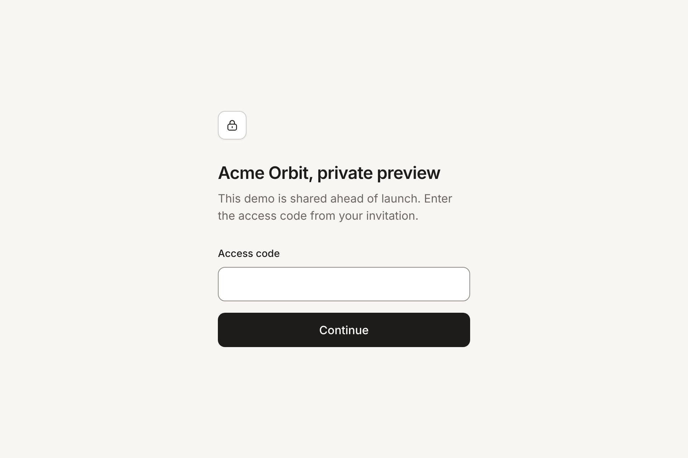

# next-access-gate

A password gate for Next.js 16 demos and presentations deployed on Vercel: a `proxy`, a signed cookie and a minimal, customisable access page.

> **Scope.** This is a wall for demos, previews and talks, not authorisation. It keeps a link you shared from being casually browsed or indexed. Everyone who knows a code sees the same thing; there are no users, roles or audit trail. Anything that must stay confidential needs real authentication.

<picture>
  <source media="(prefers-color-scheme: dark)" srcset="docs/gate-dark.png">
  
</picture>

- Plain HTML form, works with JavaScript disabled.
- Several codes at once (rotation, one code per audience); removing a code signs out exactly the people who used it.
- Signed, expiring `HttpOnly` cookie built on Web Crypto; no runtime dependencies.
- Fails closed when no code is configured, outside local development.
- `noindex` and `private, no-store` on the gate and on every protected response, so no shared cache keeps a copy.
- Anonymous requests to public paths are read-only: server actions cannot be triggered from the gate page.

## Install

```sh
npm install @kud/next-access-gate
```

Requires Node 22 or later, `next` 16 or later and `react` 19 or later.

## Setup

One configuration module and three thin files. Paths below are the defaults.

```ts
// access-gate.ts
import { createAccessGate } from "@kud/next-access-gate"

export const gate = createAccessGate({
  codes: process.env.ACCESS_GATE_CODES,
  secret: process.env.ACCESS_GATE_SECRET,
  whenUnset: "closed",
  allow: ["/og", "/api/health"],
  paths: { page: "/access", verify: "/access/verify", logout: "/access/logout" },
})
```

```ts
// proxy.ts
import { gate } from "./access-gate"

export const proxy = gate.proxy

export const config = {
  matcher: ["/((?!_next/static|_next/image|favicon.ico).*)"],
}
```

Next.js reads `matcher` statically at build time, so it has to be a literal in your own `proxy.ts`; the package cannot ship it. Keep it this narrow. It only skips the build output (`_next/static`), the image optimiser (`_next/image`, whose internal fetches still go through the proxy) and the favicon. Every other exception (the gate's own routes, metadata images, your `allow` list) is decided at runtime by `gate.proxy`, which is the one place an allowlist lives.

Excluding file extensions in the matcher, as many examples do, is unsafe here: a dynamic segment such as `/files/[name]` or `/api/export/[id]` would serve `/files/report.png` or `/api/export/q3.txt` to anyone, because the extension is only part of a URL, not proof of a static file. The cost of the narrow matcher is that files in `public/` sit behind the gate too, which is usually what a private demo wants. Assets the gate page itself shows, such as a logo, go in a folder listed in `allow` (for example `allow: ["/brand"]` and `public/brand/logo.svg`). `next/image` cannot optimise a gated file, since the optimiser fetches it without the visitor's cookie: mark such images `unoptimized`, or keep them in an allowed folder.

```ts
// app/access/verify/route.ts
import { gate } from "../../../access-gate"

export const POST = gate.verify
```

```ts
// app/access/logout/route.ts
import { gate } from "../../../access-gate"

export const POST = gate.logout
export const GET = gate.logout
```

```tsx
// app/access/page.tsx
import { AccessGatePage } from "@kud/next-access-gate/page"
import { gate } from "../../access-gate"

export default function Page(props: PageProps<"/access">) {
  return <AccessGatePage gate={gate} searchParams={props.searchParams} title="Acme, private preview" />
}
```

A sign-out link is a plain form: `<form method="post" action="/access/logout"><button>Sign out</button></form>`.

## Environment variables

| Variable             | Required    | Meaning                                                                                        |
| -------------------- | ----------- | ---------------------------------------------------------------------------------------------- |
| `ACCESS_GATE_CODES`  | yes         | Comma-separated access codes. Whitespace is trimmed and empty entries are dropped.             |
| `ACCESS_GATE_SECRET` | recommended | Signing secret of at least 32 random characters, for example `openssl rand -base64 32`.         |

On Vercel, set them per environment (Production, Preview) and redeploy. Both are read on the server only; the page and client entries never touch them, and the test suite checks that neither the built entries nor the example's browser bundles contain them.

## Choosing codes

Codes are compared without regard to case by default (`caseSensitive: true` changes that). A code is the only thing between the internet and your demo, so it deserves some entropy: three random words, such as `velvet-harbour-lantern`, are easy to say aloud in a meeting and far harder to guess than a short word. The gate logs a warning for any code shorter than 10 characters.

Several codes can be active at once:

- **Rotation**: add the new code, share it, then remove the old one.
- **Per audience**: give each client or event its own code. With a secret set, removing a code signs out exactly the sessions opened with it, because each cookie carries an identifier derived from its code.

A wrong code is answered after a fixed delay of about 400 ms. There is no rate limiting; Vercel's firewall rules are the right place for that if you need it.

## The secret, and what happens without one

With `ACCESS_GATE_SECRET` set, cookies are signed with a key derived from it. Sessions survive code changes, except for sessions opened with a code you remove.

Without it, the key is derived from the sorted list of codes. That is convenient and still safe against forgery, with two trade-offs:

- If a cookie leaks, someone can try candidate codes offline against its signature, which makes a short code recoverable. A long code, or a secret, closes that door.
- Any change to the list of codes changes the key, which signs everyone out.

Changing the secret also signs everyone out, which is a quick way to revoke every session.

## When no code is set

`whenUnset` decides what happens when `ACCESS_GATE_CODES` is empty or missing:

- `"closed"` (the default, except when `NODE_ENV` is `development`): every request gets a `503` page saying the gate is not configured. The app is never served, so a forgotten variable cannot publish the demo.
- `"open"`: no wall at all. Useful for local development, which is why it is the default there.

An explicit value wins over the default in every environment.

`enabledIn: ["production", "preview"]` switches the gate off entirely elsewhere, based on `VERCEL_ENV`. Outside Vercel, `NODE_ENV=production` counts as `production` and anything else as `development`.

## What stays public

Always public: `/_next/…`, the three gate routes, `/favicon.ico` and `/robots.txt`.

Public by default: the root-level metadata images, by exact path, so link previews still render when you paste the URL into a chat. That is `/opengraph-image` and `/twitter-image` (bare or with `.png`, `.jpg`, `.jpeg` or `.gif`), `/icon` (bare or with `.ico`, `.png`, `.jpg`, `.jpeg` or `.svg`) and `/apple-icon` (bare or with `.png`, `.jpg` or `.jpeg`); the full list is exported as `DEFAULT_METADATA_IMAGES`. Nested ones such as `/blog/opengraph-image` stay behind the wall unless you list them: `publicMetadataImages` takes an array of exact paths instead (`[...DEFAULT_METADATA_IMAGES, "/blog/opengraph-image"]`), or `false` if the preview image itself is confidential. Names are never matched by pattern, so a page or route that merely ends in `icon` or `.png` is not exposed.

`allow` adds your own entries. A string matches that path and everything below it (`"/og"` matches `/og` and `/og/cover`, not `/ogre`); `"/"` matches the home page only; a `RegExp` is tested against the pathname.

Everything else needs a valid cookie. Without one, `/api/*` gets `401` JSON and pages get a `307` to the gate with `?next=` set to the original path and query. After a valid cookie, responses carry `X-Robots-Tag: noindex, nofollow` and `Cache-Control: private, no-store`, which replaces the `s-maxage` Next.js would otherwise send for a static page; a CDN in front of the app therefore never caches protected content for the next visitor.

Public paths are for reading. Without a valid cookie, any request to them that could run server code is refused with `403`: a `Next-Action` header, or any method other than `GET` and `HEAD`, apart from the gate's own `POST` to verify and logout. This matters because a server action is a `POST` to whichever page uses it, and the gate page shares your root layout, so an action referenced there would otherwise be callable by anyone. If you need an anonymous `POST` endpoint, such as a webhook, exclude its path in the matcher so that the proxy never sees it, and authenticate it on its own terms.

## Server actions

The proxy is a first line, not the only one. Next.js recommends checking authorisation inside each server action, because a matcher change or a refactor can move an action out of the proxy's reach without anyone noticing. `isAuthenticated` accepts the headers a server action receives:

```ts
"use server"
import { headers } from "next/headers"
import { gate } from "./access-gate"

export const saveNote = async (note: string) => {
  if (!(await gate.isAuthenticated(await headers()))) throw new Error("unauthorised")
  // …
}
```

## How it works

- **Verify** accepts a form post (`303` to `next` on success, `303` back to the page with `?error=1&next=…` on failure) or JSON (`{ code, next }` answered with `{ ok, next }` or `401`). `next` is reduced to a same-site path; protocol-relative URLs, backslashes, absolute URLs and the gate's own routes fall back to `/`.
- **Codes** are compared by HMAC-ing the submitted code and every configured code with the key, then comparing digests in constant time, always across the whole list.
- **The cookie** is `v1.<kid>.<exp>.<sig>`: `kid` is the first 8 bytes of `HMAC(key, "kid:" + code)`, `exp` is a Unix timestamp (30 days by default, fixed, not sliding), and `sig` is `HMAC-SHA-256(key, "v1.<kid>.<exp>")`, base64url-encoded. It is checked for version, signature, expiry and a `kid` that belongs to a current code.
- **Cookie attributes**: `__Host-access-gate` with `Secure; Path=/` and no `Domain` over HTTPS; `access-gate` over plain HTTP such as `http://localhost`. Always `HttpOnly; SameSite=Lax; Max-Age=<maxAge>`.
- **Headers**: the gate page, verify, logout, every redirect and every protected response the proxy lets through send `Cache-Control: private, no-store` and `X-Robots-Tag: noindex, nofollow`; the page also renders a robots `meta` tag.

## Customisation

There are three levels, from least to most work.

### 1. Props

```tsx
<AccessGatePage
  gate={gate}
  searchParams={props.searchParams}
  locale="fr"
  title="Démo Acme"
  description="Saisissez le code reçu avec l’invitation."
  logo={}
  copy={{ submitLabel: "Entrer" }}
  theme={{ accent: "#0b6e4f", radius: "6px", font: "Inter, sans-serif" }}
/>
```

`title`, `description`, `logo`, `label`, `placeholder`, `submitLabel` and `errorText` override one string each; `copy` overrides any of them for the chosen `locale` (`"en"` or `"fr"`). `theme` sets design tokens, which map to CSS custom properties:

| Token         | Property             |
| ------------- | -------------------- |
| `bg`          | `--nag-bg`           |
| `fg`          | `--nag-fg`           |
| `muted`       | `--nag-muted`        |
| `accent`      | `--nag-accent`       |
| `accentFg`    | `--nag-accent-fg`    |
| `ring`        | `--nag-ring`         |
| `error`       | `--nag-error`        |
| `radius`      | `--nag-radius`       |
| `font`        | `--nag-font`         |
| `fieldBg`     | `--nag-field-bg`     |
| `fieldBorder` | `--nag-field-border` |
| `markBg`      | `--nag-mark-bg`      |

The defaults are declared with zero specificity, so a rule such as `.nag-root { --nag-accent: #0b6e4f }` in your own stylesheet also wins, and can differ per colour scheme. Each part of the page carries a `.nag-*` class (`.nag-root`, `.nag-mark`, `.nag-title`, `.nag-description`, `.nag-form`, `.nag-label`, `.nag-input`, `.nag-button`, `.nag-error`).

### 2. Client form

`@kud/next-access-gate/client` is a client entry with a hook and an unstyled form that posts JSON and falls back to a normal form post without JavaScript.

```tsx
"use client"
import { AccessGateForm, useAccessGate } from "@kud/next-access-gate/client"

export const Gate = ({ next }: { next: string }) => (
  <AccessGateForm verifyPath="/access/verify" next={next} className="my-form" />
)

export const useGate = () => useAccessGate({ verifyPath: "/access/verify" })
// → { submit(code, next?), pending, error }
```

### 3. Your own page

Any page that posts `code` and `next` to the verify route works, either as `application/x-www-form-urlencoded` or as JSON. Read `?error=1` and `?next=` from the search params; `safeNext` is exported to sanitise the latter.

## Options

| Option                 | Default                                                | Notes                                                       |
| ---------------------- | ------------------------------------------------------ | ----------------------------------------------------------- |
| `codes`                | required                                               | Comma-separated string or array.                            |
| `secret`               | none                                                   | See above. Warns under 32 characters.                       |
| `whenUnset`            | `"closed"` (`"open"` when `NODE_ENV` is `development`) | `"closed"` or `"open"`.                                     |
| `enabledIn`            | always enabled                                         | Subset of `"production"`, `"preview"`, `"development"`.     |
| `allow`                | `[]`                                                   | Strings or regular expressions.                             |
| `paths`                | `/access`, `/access/verify`, `/access/logout`          | Keep them in sync with your route files.                    |
| `caseSensitive`        | `false`                                                |                                                             |
| `maxAge`               | 30 days                                                | Seconds.                                                    |
| `publicMetadataImages` | `true`                                                 | `true`, `false` or an array of exact paths. See above.      |
| `failureDelayMs`       | `400`                                                  | Delay before answering a wrong code.                        |

The returned gate exposes `proxy`, `verify`, `logout`, `isAuthenticated(requestOrHeaders)`, `paths` and `status` (`"active"`, `"open"`, `"unconfigured"` or `"disabled"`).

## Not covered

- `basePath` and internationalised routing are not handled in this version.
- No rate limiting beyond the fixed delay.
- No per-user identity, logging or audit trail, by design.

## Development

```sh
npm install
npm run typecheck
npm test
npm run e2e          # builds the package and example/, then runs Playwright
npm run screenshots  # regenerates docs/gate-light.png and docs/gate-dark.png
```

`example/` is a small Next.js app using the workspace package; it doubles as the demo deployment. If Playwright's own Chromium is not installed, point `PLAYWRIGHT_CHROMIUM_EXECUTABLE_PATH` at a local Chromium binary.

## Licence

MIT
